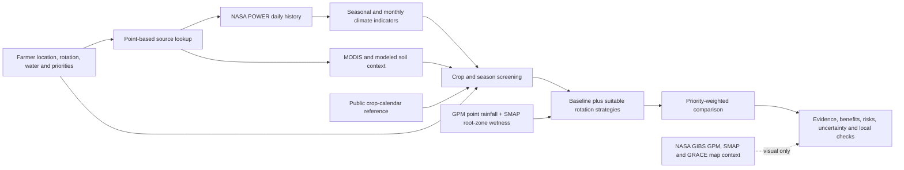

# FieldShift — NASA Space Apps Challenge 2026 submission

## One-line summary

FieldShift turns NASA Earth observations and farmer-provided context into an explainable comparison of crop rotations, helping farmers and local advisors explore options for healthier, more climate-resilient fields.

## The problem

Farmers must make rotation choices while rainfall shifts, heat and dry spells threaten crops, and soil condition affects future seasons. A crop that helps in one place can be a poor fit elsewhere because of water limits, growing-season length, soil, markets, equipment or local pest pressure. Earth-observation data can show environmental patterns, but those patterns are hard to translate into a practical decision. Many tools either stop at maps and indicators or present a recommendation without showing its evidence and uncertainty.

## Our approach

FieldShift makes the comparison itself the product. A farmer describes a location, soil and water situation, current rotation and priorities. The app retrieves historical NASA POWER daily climate data for the point, derives interpretable seasonal indicators, and screens a crop library against climate and growing-season rules. It then compares the current rotation with up to three alternatives: legume-integrated, water-saving and soil-cover, when the location's crop screen finds a suitable candidate. The weights respond to farmer priorities, and every strategy exposes its score components, reasons, evidence, risks and missing information.

Optional satellite and contextual sources add perspective without being misrepresented as field measurements: recent MODIS products show current-land-cover greenness, evapotranspiration, surface temperature and land cover; SoilGrids adds modeled soil context; Copernicus elevation supports an approximate slope class. A global AgMIP-GGCMI crop calendar provides static multi-year average planting windows and season lengths for 18 major crops on a 0.5° grid, with rainfed and irrigated references. Farmers can apply a reference sowing month to their selected crop or keep the climate-derived month. A local-crops panel can surface crop mentions from nearby Wikipedia articles, explicitly labeled as text clues rather than production data. A what-if control lets users stress-test the ranking against uniform rain and temperature shifts; it is a sensitivity exercise, not a forecast.

## What makes it useful

- **Farmer priorities shape the comparison.** Users can emphasize water, income, soil health or erosion protection rather than accept one universal ranking.
- **The output is explainable.** Scores are built from editable, readable rules. Evidence is connected to crops and seasons, and users can inspect the factors behind the score.
- **Trade-offs stay visible.** Each strategy includes potential benefits, risks for local review, information gaps and a confidence level.
- **It starts from the farmer's baseline.** The existing rotation is the reference point, so the question is how a candidate changes the trade-offs.
- **It is accessible without an account or server.** The browser-based flow supports place search, map selection and coordinates, and offers a printable comparison.

## Earth observations and analysis

NASA POWER daily data from 2005 through the current year derives temperature and frost/heat exposure, humidity, solar radiation and estimated reference evapotranspiration. Its high-resolution point pathway supplies GPM IMERG daily precipitation (~10 km) in UTC, which drives rainfall variability, dry spells, heavy-rain exposure and crop-season water balance where valid; NASA POWER precipitation fills missing GPM days. The same pathway supplies SMAP L4 root-zone wetness (~9 km) from 2015 onward; low seasonal wetness can add a small, bounded drought-risk adjustment for drought-sensitive crops. Recent dates can be incomplete; fill values are excluded, and only complete years enter annual trend summaries. The crop screen checks thermal suitability, sowing conditions, frost constraints and seasonal water demand. Where a supported crop calendar exists for the nearest grid cell, farmers can compare or apply its historical planting reference; crop selection and rotation scores remain transparent rule-based screening. Candidate rotations are ranked using documented component scores and farmer-selected priority weights. MODIS and modeled SoilGrids context can contribute to evidence and scoring where supported. NASA GIBS displays GPM, SMAP and GRACE/GRACE-FO maps in the main results; raster colors are never sampled into point values. GRACE remains broad water-storage context and does not measure an individual well.

### Spatial-informatics method

The selected farm point is used to request each source independently. Daily climate and GPM rainfall records are aggregated into seasonal and monthly features; SMAP root-zone wetness is summarized over crop windows, while vegetation, evapotranspiration, temperature, land-cover, soil and terrain products retain their own native pixel sizes and time windows. Those features meet in the crop-season screening and explanation layer, with source, date range, resolution and limitations carried into the result. FieldShift does not resample every product to a fictitious common field resolution. NASA GIBS remains visual context, and GRACE remains too coarse to support a field-level score.

This is an explainable decision-support prototype, not an AI agronomist. Crop-library values and the generic SMAP wetness trigger need regional agronomy review. The global crop calendar is a static historical composite with gap-filling and spatial extrapolation; it covers a subset of major crops at regional resolution and does not encode crop-rotation outcomes. The app does not predict yield or profit. NASA POWER's climate grid can miss local rainfall and topography; GPM and SMAP use different grids and periods; SoilGrids is modeled; and MODIS pixels may combine multiple land uses. NASA GIBS adds GPM, SMAP and GRACE/GRACE-FO visual map context, but these images are never sampled into point values or scoring inputs. GRACE's regional total-water-storage signal is not a well-level groundwater measurement. Farmers can save soil-test values and a local price quote in their browser; these are self-reported and do not change rankings. Local varieties, current planting calendars, prices, soil tests, water rights, disease history, labor and equipment constraints are not fully represented.

## Intended impact

FieldShift aims to make climate and Earth-observation information easier to discuss at the field and advisory level. A farmer can see which rotation options appear to fit the recorded conditions, what each option may improve, what it may cost, and what needs checking before acting. The expected immediate impact is better-informed conversations and more targeted local validation—not an automated change in planting practice.

## Responsible use

Every analysis is framed as exploratory. FieldShift does not issue a planting prescription, yield guarantee, profit forecast, irrigation schedule, pest diagnosis or soil-health certification. Users should review suggestions with local farmers, extension workers or agronomists and validate soil, water, market and calendar assumptions before changing a rotation. Confidence should remain limited when supporting data are coarse, missing or unvalidated.

## Demo-ready status and next steps

The deployable prototype includes a location-to-comparison experience, live climate and water retrieval, location-specific crop screening, strategy comparisons, evidence explanations, uncertainty, local-crop clues, field evidence capture and print-friendly results. The next stage is a pilot with farmers and extension partners: validate crop parameters and calendars, compare the NASA point series with station and soil-test observations, document disagreements, and revise the scoring rules with local expertise. GRACE remains visual context; market-data connections depend on reliable public or licensed local coverage.

## Suggested judging category alignment

- **Earth observation:** translates NASA POWER history and optional MODIS evidence into seasonal crop-relevant indicators.
- **Innovation:** connects those indicators to editable rotation strategies and farmer-selected priorities, with evidence and uncertainty visible together.
- **Impact:** supports more informed, locally reviewable rotation decisions and highlights where data or expertise is missing.
- **Execution:** delivers a usable browser prototype with a clear workflow, live data sources, explainable scoring and a printable result.

For a requirement-by-requirement coverage check and the live-demo evidence path, see [`HACKATHON_REQUIREMENTS.md`](HACKATHON_REQUIREMENTS.md). The NASA POWER daily API serves point time series from 1981 to near real time, and its source grid resolution is retained in FieldShift's interpretation. [NASA POWER Daily API documentation](https://power.larc.nasa.gov/docs/services/api/temporal/daily/)

## Credits and status

Built for the NASA Hackathon 2026 challenge on resilient crop rotations. Independent community prototype; not an official NASA product and not endorsed by NASA. Data sources and limitations are documented in the app's Learn and Data used sections and in the repository README.
